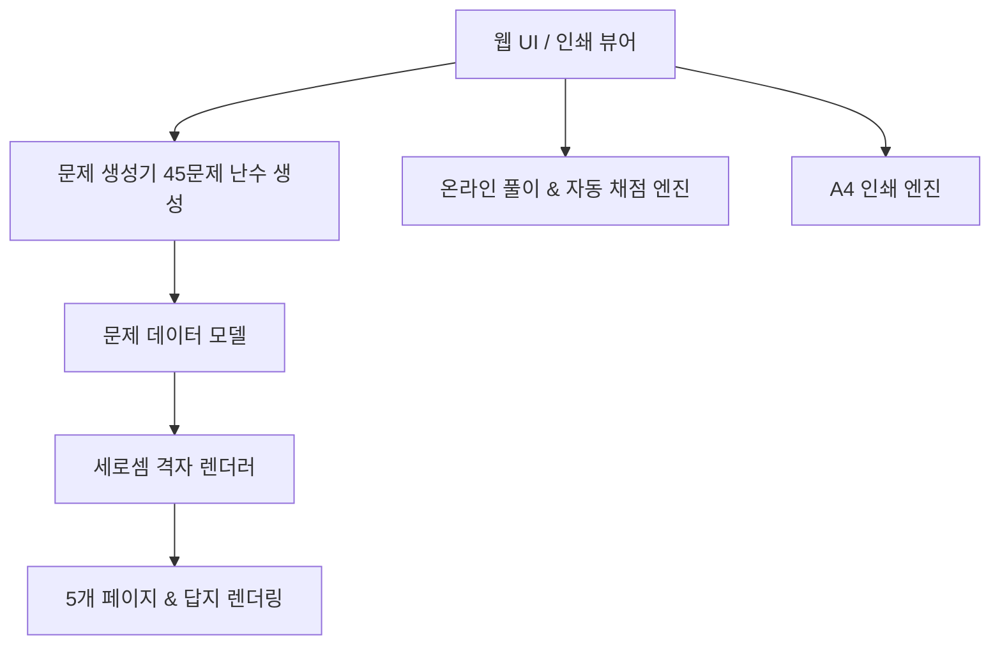

# 초등 2학년 두 자릿수 X 한 자릿수 세로셈 학습지 구현 계획 (Implementation Plan)

**Goal:** 초등학교 2학년을 위한 파스텔 동화풍 세로셈 곱셈(두 자릿수 X 한 자릿수) 5페이지 학습지(페이지당 9문제, 총 45문제) 및 답지 웹 앱 개발

**Architecture:** 
외부 서버나 복잡한 프레임워크 없이 브라우저에서 바로 열 수 있는 경량 고성능 웹 앱 (HTML5 + CSS3 + Vanilla JavaScript).
반응형 및 정밀 `@media print` 스타일을 지원하여 웹 화면 풀이와 A4 용지 1페이지당 9문제씩 딱 맞게 인쇄되는 출력 기능을 완벽 지원.

**Architecture Diagram:**

**Tech Stack:** HTML5, CSS3 (Flexbox/Grid, @media print, CSS Variables), Vanilla JavaScript (ES6+)

---

### Task 1: 데이터 모델 및 문제 생성 로직 구현
- **파일:** `script.js`
- **내용:** 
  - 10~99 범위의 두 자릿수와 2~9 범위의 한 자릿수를 무작위 생성
  - 각 문제별 풀이 단계 데이터 생성:
    - 윗수 (num1), 아랫수 (num2)
    - 1단계 (일의 자리 곱): `(num1 % 10) * num2`
    - 2단계 (십의 자리 곱): `Math.floor(num1 / 10) * 10 * num2`
    - 최종 결과: `num1 * num2`
  - 총 45문제 (9문제 * 5페이지)를 생성하는 함수 및 단위 검증

### Task 2: 기본 HTML 구조 및 파스텔 동화 테마 UI 구축
- **파일:** `index.html`, `style.css`
- **내용:**
  - 상단 툴바: 문제 새로고침, 정답 보기/숨기기 토글, 채점하기, A4 인쇄하기, 페이지 바로가기 탭
  - 동화풍 테마: 베이비 핑크(#FFF5F5), 소프트 라벤더 그레이(#7B6B8D), 파스텔 포인트 컬러, 솜사탕 구름/별/달/토끼/곰돌이 데코
  - 5개 페이지 컨테이너 및 6번째 답지 페이지 레이아웃

### Task 3: 세로셈 격자 렌더링 및 인터랙티브 풀이/채점 기능
- **파일:** `script.js`, `style.css`
- **내용:**
  - 예시 양식에 맞춘 9칸 세로셈 레이아웃 (십의 자리, 일의 자리 정렬, 계산 단계별 줄바꿈)
  - 웹 화면에서 직접 입력 가능한 입력창 (`<input maxlength="1">`) 제공
  - '채점하기' 클릭 시 각 네모칸 정답/오답 확인 및 점수/스티커 축하 애니메이션
  - '정답 보기' 클릭 시 모든 정답이 채워진 모드로 전환

### Task 4: A4 인쇄(@media print) 완벽 대응 및 브라우저 테스트
- **파일:** `style.css`, `index.html`
- **내용:**
  - `@media print` 규격: 상단 툴바 숨김, A4 페이지 분할 (`page-break-after: always;` / `break-after: page;`)
  - 각 페이지당 정확히 9문제가 여백 넉넉하게 3x3 격자로 A4 1장에 인쇄되도록 설정
  - 5페이지 학습지 + 답지 페이지가 깔끔하게 출력되는지 Playwright 헤드리스 브라우저로 캡처 및 검증
